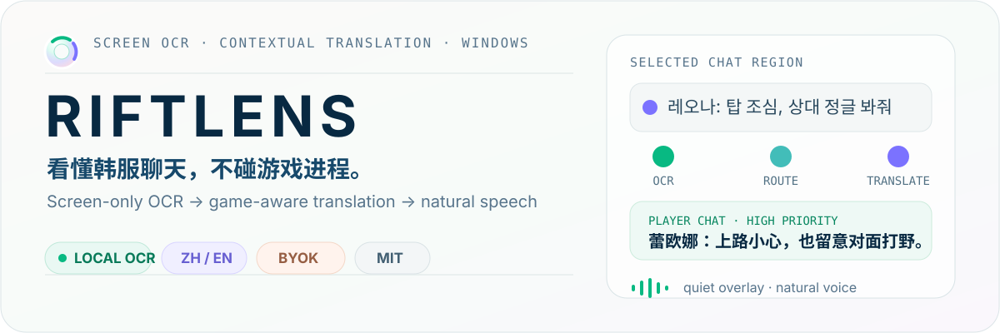
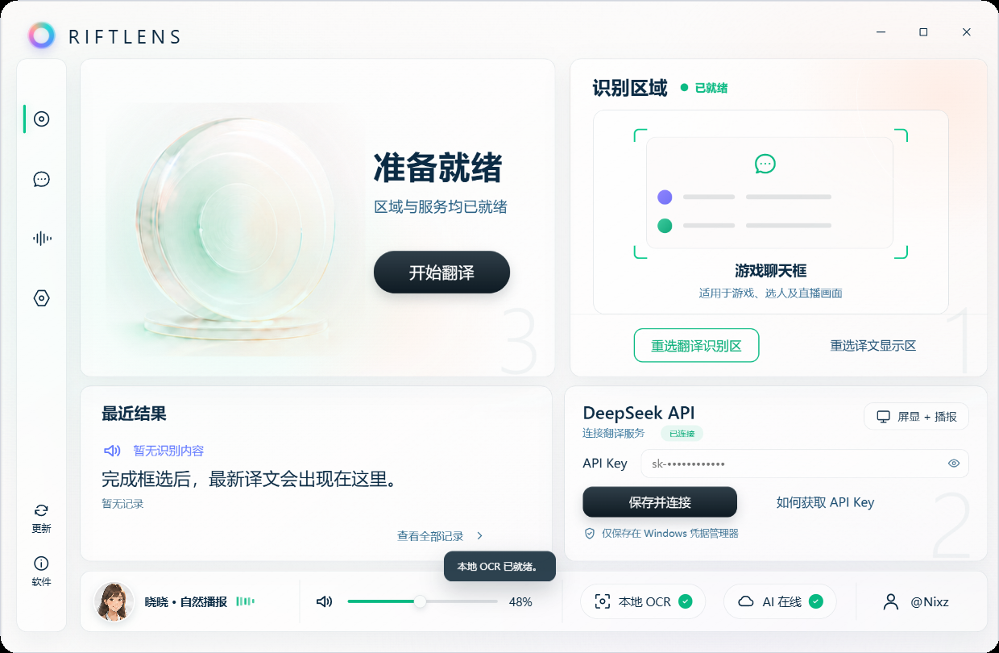
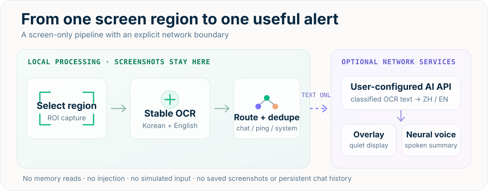
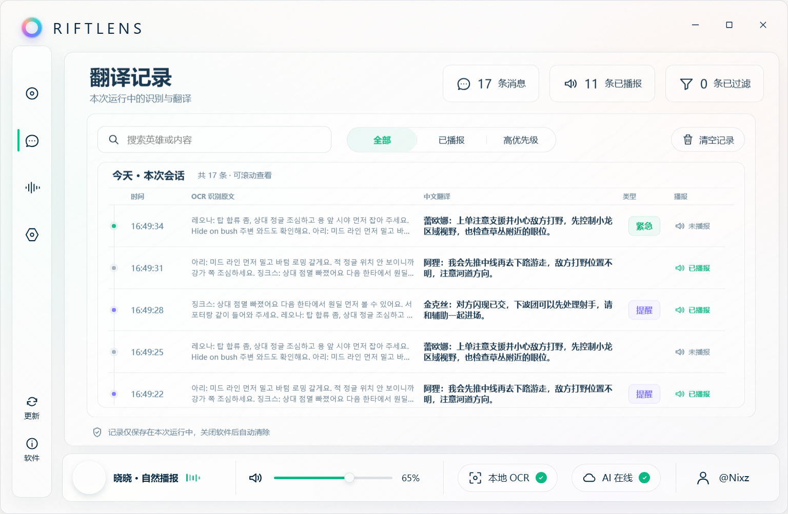
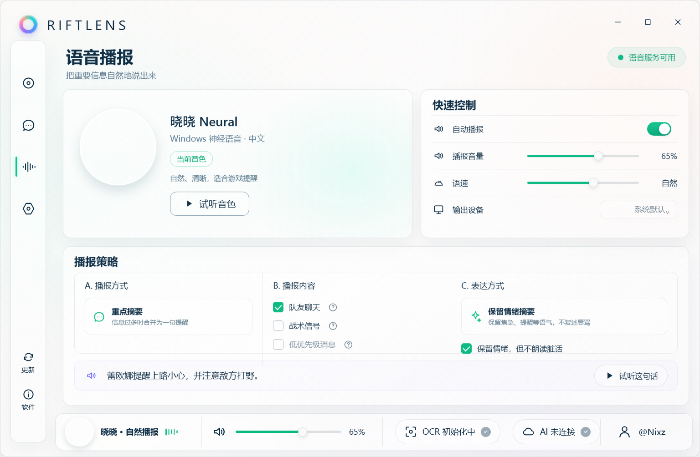

<div align="center">
  
</div>

<div align="center">
  <a href="README.md">简体中文</a> · <a href="README.en.md">English</a>
  <br><br>
  
  
  
  
</div>

> [!IMPORTANT]
> RiftLens is a working personal MVP, not an official Riot Games product. Read the [compatibility disclaimer](#game-compatibility-and-disclaimer) before use; a low-impact design is not a zero-risk promise.

## What it is

RiftLens is a Windows screen translator for **Korean League of Legends matches, champion-select chat, and livestreams**. Select a screen region and it performs capture, change detection, and Korean/English OCR locally. Only classified text is passed to an AI endpoint configured by the user, then shown as a low-distraction overlay or spoken naturally.

It does not read game memory, inject into the game, simulate keyboard or mouse input, send chat messages, or bundle an API key.

<div align="center">
  
</div>

## Where it helps

| Scenario | What RiftLens does |
| --- | --- |
| Korean-server matches | Recognizes player chat, filters most system events, and translates or speaks important content |
| Champion select | Lets the user select the chat area instead of assuming a fixed HUD position |
| Korean livestreams | Works as a flexible Korean on-screen text translator for stream chat or captions |
| OCR/translation experiments | Provides a compact WinForms, WebView2, Tesseract, and OpenAI-compatible reference implementation |

## Highlights

- **Screen-only input.** Select the recognition region and, optionally, a separate translation display region. The main window hides while selecting and returns afterwards.
- **Bundled OCR.** Lightweight `kor` and `eng` `tessdata_fast` models require no separate Korean language-pack download.
- **Rolling-chat handling.** Small-region sampling, change detection, stabilization, partial-line rejection, timestamp cleanup, and scroll deduplication work together.
- **Classify before translating.** Player chat, tactical pings, kill events, system events, and unknown text have separate paths. Player chat always has speech priority.
- **Faithful speaker turns.** Consecutive lines from one player are grouped and summarized when the speaker changes. Concrete meaning is retained instead of being reduced to “a teammate is communicating.”
- **Safer speech without erasing emotion.** Normal messages retain meaning. Hostile wording is removed while useful tactics and general emotional tone are preserved where possible.
- **No guessed champions.** A 173-champion Korean, Chinese, and English dictionary based on Data Dragon 16.14.1 is used only when a champion name is actually present.
- **Natural speech with fallback.** Chinese uses `zh-CN-XiaoxiaoNeural`; English uses `en-US-JennyNeural`. RiftLens falls back quietly to an installed Windows voice when online synthesis is unavailable.
- **Game-friendly presentation.** The overlay does not activate, is click-through, and is excluded from its own captures. A compact floating control handles pause, resume, volume, and mute.
- **Chinese and English UI.** The interface, AI output, tactical signals, history labels, and voice language switch together and are covered by interaction tests.

## Data flow

<div align="center">
  
</div>

| Data | Destination | Persisted by RiftLens |
| --- | --- | --- |
| Selected-region screenshots | In-memory change detection and local Tesseract OCR only | No |
| New OCR text, speaker label, champion matches, and summary preferences | User-configured OpenAI-compatible translation endpoint | No |
| AI-generated spoken summary | Microsoft Edge online speech when neural speech is enabled | No |
| API key | Windows Credential Manager under `RiftLens/TranslationApi` | Yes, protected for the current Windows user |
| Other settings and coordinates | `%LOCALAPPDATA%\RiftLens\settings.json`, without the key | Yes |
| Translation history | Current process memory and UI only | Cleared on exit |

See [PRIVACY.md](PRIVACY.md) for the complete bilingual privacy notes. Text sent to third-party services is governed by their respective policies.

## Quick start

### Requirements

- Windows 10 22H2 or Windows 11, x64.
- Microsoft Edge WebView2 Runtime, normally present on current Windows installations.
- The smaller build requires .NET 8 Desktop Runtime; the self-contained build does not.
- Borderless windowed mode is recommended. Third-party overlays are not guaranteed in exclusive fullscreen.

### Run from source

```powershell
git clone https://github.com/Nixz0824/RiftLens.git
cd RiftLens
powershell -NoProfile -ExecutionPolicy Bypass -File ./build.ps1
powershell -NoProfile -ExecutionPolicy Bypass -File ./run.ps1
```

`build.ps1` builds the app and test project, then runs the local regression suite. It never asks for or reads your translation API key.

### First run

1. Select only the chat or on-screen text area you want RiftLens to recognize.
2. Wait for the bundled OCR status to become ready.
3. Configure an OpenAI Chat Completions-compatible endpoint, model, and your own API key.
4. Select **Start translating**, then return to the game. The first scan establishes a baseline and does not read old messages aloud.
5. Compare the “OCR source” and translation columns on the History page to tune HUD scale, chat font size, and selection bounds.

> [!NOTE]
> RiftLens is BYOK (Bring Your Own Key). It does not provide, share, or preconfigure a DeepSeek/OpenAI key. DeepSeek is only the default; the compatible endpoint and model are configurable.

## Interface

<table>
  <tr>
    <td width="50%"></td>
    <td width="50%"></td>
  </tr>
  <tr>
    <td align="center"><strong>Translation history</strong><br>Search, filter, scroll, expand, and compare OCR source with translation</td>
    <td align="center"><strong>Natural speech</strong><br>Control volume, speech density, tactical signals, and emotion handling</td>
  </tr>
</table>

The home page keeps onboarding to three steps: recognition region, API, and start. Detailed filters, overlay behavior, runtime options, and language live in Settings. The main UI is packaged local WebView2 content; in-game overlays remain lightweight native windows.

## Architecture

```text
RiftLens/
├─ Models/       Settings, regions, and translation contracts
├─ Services/     Capture, preprocessing, OCR, deduplication, classification, AI, and speech
├─ UI/           WinForms shell, region selector, translation overlay, and floating control
├─ WebUI/        Locally packaged HTML, CSS, and JavaScript UI
└─ Assets/       Champion dictionary and Korean/English OCR models

RiftLens.SelfTest/
├─ Program.cs                    Core and boundary regression tests
└─ webui-interaction-test.js     Real click tests for Chinese and English UI
```

See [docs/ARCHITECTURE.md](docs/ARCHITECTURE.md) for responsibilities, thread boundaries, and extension points. The project intentionally remains two .NET projects with no server, database, or heavy frontend toolchain.

## Build and test

```powershell
# Build and run core self-tests
powershell -NoProfile -ExecutionPolicy Bypass -File ./build.ps1

# Run bilingual WebUI click tests separately (Microsoft Edge required)
node ./RiftLens.SelfTest/webui-interaction-test.js

# Smaller output; .NET 8 Desktop Runtime required on the target PC
powershell -NoProfile -ExecutionPolicy Bypass -File ./publish.ps1

# Larger standalone output
powershell -NoProfile -ExecutionPolicy Bypass -File ./publish.ps1 -SelfContained
```

Outputs go only to the Git-ignored `artifacts/` directory. Windows CI builds, runs core tests, checks both UI languages, and produces a downloadable build artifact without publishing a release.

## Current limitations

- OCR accuracy varies with chat size, HUD scale, moving backgrounds, font outlines, stream compression, and selected bounds; no fixed accuracy rate is claimed yet.
- Classification favors avoiding system-message speech, but new client versions and custom localization may still introduce unknown formats.
- Regions currently use absolute screen coordinates and may need re-selection after display, resolution, or window-position changes.
- AI translation and neural speech depend on the user's network and third-party service availability.
- This is a source-first personal MVP. Public release binaries should first be tested in real matches, on a clean Windows install, and with current antivirus software.

## Game compatibility and disclaimer

RiftLens processes screen pixels only. It does not read or modify the game process, inject code, capture game network traffic, automate controls, or send messages. These boundaries reduce integration and performance risk, but **they are not Riot Games approval and do not guarantee compatibility, account safety, or zero ban risk**. Rules and anti-cheat behavior can change; users are responsible for checking current Riot Games terms, platform rules, and local law.

RiftLens isn't endorsed by Riot Games and doesn't reflect the views or opinions of Riot Games or anyone officially involved in producing or managing Riot Games properties. Riot Games and all associated properties are trademarks or registered trademarks of Riot Games, Inc.

League of Legends, champion names, Data Dragon data, and related properties belong to Riot Games or their respective owners. This repository contains no game-client assets; champion-name mappings are used only for interoperability and contextual translation.

## License and third parties

Original RiftLens source code is licensed under the [MIT License](LICENSE), Copyright © 2026 Nixz. Third-party software and data retain their own licenses, including Tesseract, tessdata_fast, the Tesseract .NET wrapper, Leptonica, NAudio, Microsoft WebView2, and Riot Data Dragon. See [THIRD_PARTY_NOTICES.md](THIRD_PARTY_NOTICES.md).

When Microsoft online speech is used, its voices and service remain subject to Microsoft's terms and availability. RiftLens does not own or resell those voices.

## Contributing and security

- Read [CONTRIBUTING.md](CONTRIBUTING.md) before opening a pull request.
- Follow [SECURITY.md](SECURITY.md) for sensitive reports. Never paste keys, private chat, or local paths into a public issue.
- See [CHANGELOG.md](CHANGELOG.md) for notable changes.

Independent developer: **Nixz** (GitHub [@Nixz0824](https://github.com/Nixz0824)). Issues and focused pull requests are welcome; please keep the project small and understandable.
