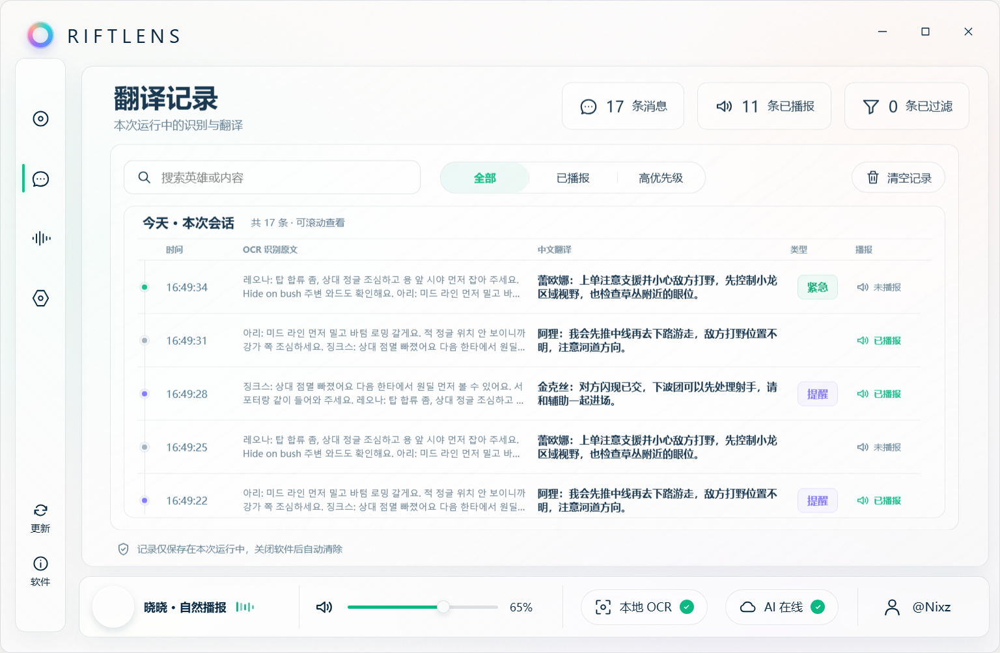

<div align="center">
  
</div>

<div align="center">
  <a href="README.md">简体中文</a> · <a href="README.en.md">English</a>
  <br><br>
  
  
  
  
  
</div>

> [!IMPORTANT]
> **RiftLens is a personal, runnable MVP built with a vibe-coding workflow — not an official Riot Games product.** Please read the [Game Compatibility & Disclaimer](#game-compatibility--disclaimer--游戏兼容性与免责声明) section before use. A low-intrusion design does not equal a zero-risk guarantee.
>
> RiftLens 是作者个人以 vibe coding 方式开发的可运行 MVP，并非 Riot Games 官方产品。使用前请阅读[游戏兼容性与免责声明](#游戏兼容性与免责声明)；低侵入设计不等于零风险承诺。

## RiftLens 2.0 · What Changed / 本次更新

[Download RiftLens 2.0 for Windows x64](https://github.com/Nixz0824/RiftLens-LoL-Korean-Translator-Purely-Visual/releases/tag/v2.0.0) · [下载 Windows x64 版 RiftLens 2.0](https://github.com/Nixz0824/RiftLens-LoL-Korean-Translator-Purely-Visual/releases/tag/v2.0.0)

- **More capable Korean–Chinese–English OCR. · 更完整的韩中英识别。** Bundled PP-OCRv5 Mobile Korean-English and Chinese-English recognizers now inspect the same selected screen region and fuse words by confidence and script, while a local Tesseract path remains as fallback.<br>内置 PP-OCRv5 Mobile 韩英与中英识别器会同时处理同一个用户框选区域，并按置信度和文字脚本融合结果；Tesseract 仍作为本地兜底。
- **Stable player–champion pairing. · 本局玩家与英雄稳定对应。** Repeated official champion-name hits are learned per player during the current match, so later background noise is less likely to change Jarvan IV into a wrong or non-official name.<br>同一局内会按玩家累计可信的官方英雄名命中；关系稳定后，后续背景干扰更不容易把“嘉文四世”等英雄名识别成错误或非官方名称。
- **Evidence-checked narration. · 有证据约束的语音理解。** A lightweight local semantic layer separates markers, status shares, cooldowns, requests, plans, and actual actions. `Flash - 20s` is treated as “Flash has 20 seconds remaining,” not “negative 20 seconds”; an objective ping is a marker unless the text explicitly says someone is taking it.<br>新增轻量本地语义层，区分标记、状态、倒计时、请求、计划和真实行动。`闪现 - 20s` 会被理解为“闪现还有 20 秒”，不会读成“负 20 秒”；目标 Ping 只会按标记处理，除非原文明说正在争夺。
- **Conservative fallback when meaning is uncertain. · 不确定时保守降级。** AI narration must provide an exact evidence fragment and preserve numbers, negation, targets, and action modality. Unsupported speech is silenced while the one-to-one translated text remains visible in the overlay.<br>AI 播报必须返回可在原文中核对的证据片段，并保留数字、否定、对象与行动状态；校验失败时停止该条语音，但悬浮窗仍保留逐条直译。
- **Clearer player-first controls and presentation. · 更清楚的玩家优先设置与显示。** Player chat stays translated by default; tactical signals and system categories remain independently optional. The overlay now groups lines by speaker, shows literal translated lines for 7 seconds, and uses refreshed floating-window and Windows icon rendering.<br>队友聊天仍默认翻译；战术信号与各类系统消息保持独立可选。悬浮译文按发言人分组、逐条显示直译并保留 7 秒，同时更新了悬浮窗边缘与 Windows 图标。

### 2026-08-02 Reliability Update · 可靠性更新

- **Timestamp-first parsing. · 时间戳优先解析。** Game time is treated as `minutes:seconds`, including matches beyond 24 minutes, full-width punctuation, no-space forms, and limited OCR damage. The timestamp colon is resolved before any player/content separator.<br>局内时间按“分钟:秒”处理，覆盖 24 分钟后的长局、全角标点、无空格形式和受控 OCR 损坏；先处理时间戳，再寻找玩家正文分隔符。
- **Deterministic HUD routing. · 固定 HUD 本地分流。** Common ability, summoner-spell, health/mana, item-gold, ward, objective-timer, on-my-way, danger, assist, missing-enemy, and vision messages are handled locally before free-form AI. A bare `champion + R/Q/W/E` remains a marker rather than an invented cooldown/action claim.<br>常见技能、召唤师技能、血量/蓝量、装备金币、守卫、资源倒计时、正在路上、危险、支援、敌人消失和视野消息优先由本地规则处理；只有“英雄 + R/Q/W/E”时保持标记语气，不推断冷却或已使用。
- **Source-aware speech. · 按来源播报。** Player-authored chat, player-initiated signals, unattributed game signals, and fixed system notices keep separate source labels. Only player-authored chat may use a “player says” framing; the final speech gate rechecks the latest category switches.<br>玩家手动聊天、玩家触发的信号、无发起人的游戏信号和固定系统通知保持不同来源；只有玩家手动聊天会使用“某人说”，最终语音闸门还会按最新开关再次校验。
- **Lower retained OCR memory. · 降低 OCR 常驻内存。** ONNX Runtime keeps CPU arena reuse while avoiding a fixed memory pattern for variable chat crops.<br>ONNX Runtime 保留 CPU 内存池复用，同时不再为尺寸变化的聊天截图固定内存模式。

#### Same-session replay snapshot · 同会话回放快照

| Metric · 指标 | Before · 优化前 | After · 优化后 | Relative result · 相对变化 |
| --- | ---: | ---: | ---: |
| Timestamp-prefix recall · 时间戳前缀召回率 | 3.95% | ~99.2% | +~95.3 percentage points · 约 +95.3 个百分点 |
| Routing agreement on 141 reviewed lines · 141 条人工核对消息的分类一致率 | 36.88% | 141/141 | +63.12 percentage points · +63.12 个百分点 |
| Observed bad-speech cases covered · 已观察错误播报保护覆盖 | 0/24 by the new guards · 新保护 0/24 | 24/24 | All observed cases covered · 已覆盖本次全部样例 |
| OCR process working set · OCR 进程工作集 | 250.28 MB | 183.00 MB | ~27% lower · 约下降 27% |
| OCR process private memory · OCR 进程私有内存 | 249.67 MB | 165.17 MB | ~34% lower · 约下降 34% |
| OCR latency P50 · OCR 延迟 P50 | 1064.16 ms | 1051.06 ms | ~1.2% lower; no measured slowdown · 约下降 1.2%，未测得变慢 |

These figures come from replaying the same single real-use session and a same-machine screenshot probe. The 141 labels were manually reviewed; raw captures, chat logs, annotations, replay files, local paths, and FPS/frametime data are deliberately not published. They describe regression progress on this known session, not future-match accuracy, and this pass did not primarily change OCR recognition quality.<br>这些数字来自同一段真实使用会话的前后回放，以及同机同截图探针；141 条分类真值经过人工核对。原始截图、聊天记录、人工标注、回放文件、本机路径与 FPS/帧时间数据均未公开。这些结果只说明对这段已知会话的回归改进，不能外推为未来所有对局的准确率；本轮也并非主要优化 OCR 文字识别本身。

> [!NOTE]
> 2.0 is still an early personal MVP. The new rules are deliberately conservative, but future LoL client wording, custom localisation, unusual HUD layouts, and OCR noise can still produce unknown cases. Redacted examples are welcome in Issues.
>
> 2.0 仍是个人维护的早期 MVP。新规则刻意偏保守，但 LOL 客户端后续文案、特殊汉化、少见 HUD 布局和 OCR 噪声仍可能带来未知情况；欢迎在 Issue 中提供脱敏样例。

## At a Glance · 一眼看懂

When playing on the LOL Korean server or watching Korean livestreams, even with the official language settings applied, messages from local players remain in Korean and are impossible to understand. I built this tool to solve that problem.

**RiftLens is a Windows screen text translation assistant built for LOL Korean server game chat, champion-select chat, and livestream footage.** You select a screen region; the tool captures, detects changes, and performs Korean, Chinese, and English OCR locally, then hands the filtered text to your own AI service for translation — presenting the result as a low-distraction subtitle or natural voice narration.

游玩LOL韩服或者观看直播的时候，即使有设置官方语言翻译，也会因为本土玩家消息采用韩文而无法理解。针对这个问题，我制作了这个软件。

RiftLens 是一款面向 **LOL 韩服游戏聊天、英雄选择聊天和直播画面**的 Windows 屏幕文字翻译助手。框选一块屏幕区域后，它在本地完成截图、变化检测与韩中英 OCR，再把筛选后的文字交给用户自行配置的 AI 服务翻译，并以低干扰字幕或自然语音呈现。

**It does not read game memory, inject into the game, simulate keyboard/mouse input, send messages on your behalf, or bundle any API key.**

它不读取游戏内存、不注入游戏、不模拟键鼠、不替用户发送消息，也不捆绑任何 API Key。

<div align="center">
  
</div>

## Use Cases · 适合这些场景

| Scenario · 场景 | What RiftLens does · RiftLens 做什么 |
| --- | --- |
| **LOL KR ranked / normal games**<br>LOL 韩服对局 | Recognises player chat, filters most system events, and translates or narrates what matters.<br>识别玩家发言，过滤大部分系统事件，并将重要内容翻译或播报。 |
| **Champion select**<br>英雄选择阶段 | Freely select the champion-select chat area; no reliance on fixed HUD coordinates.<br>自由框选选择英雄聊天区，不依赖固定 HUD 坐标。 |
| **Watching KR livestreams**<br>观看韩服直播 | Select the chat or subtitle region in a livestream window — works as a general Korean screen translator.<br>框选直播画面中的聊天或字幕区域，作为通用韩文屏幕翻译器使用。 |
| **OCR & contextual translation research**<br>OCR 与语境翻译研究 | Provides a compact reference implementation for WinForms, WebView2, PaddleOCR/ONNX Runtime, and OpenAI-compatible translation.<br>提供一个体量克制的 WinForms、WebView2、PaddleOCR/ONNX Runtime 与 OpenAI-compatible 参考实现。 |

## Core Features · 核心特点

- **Eyes on the screen only. · 只看屏幕。** Freely select an OCR recognition region; optionally select a separate overlay display region. The main window auto-hides during selection and restores afterwards.<br>自由框选识别区，也可单独框选译文显示区；框选时主界面自动隐藏，完成后恢复。
- **OCR works out of the box. · OCR 开箱即用。** A shared PP-OCRv5 Mobile detector feeds Korean-English and Chinese-English recognizers; word-level confidence and Unicode-script fusion preserve all three languages in one line. The previous Tesseract engine remains a local fallback.<br>内置 PP-OCRv5 Mobile 共享检测器、韩英与中英识别器；通过词状片段置信度和 Unicode 脚本融合保留同一行中的三种语言，并保留原 Tesseract 作为本地兜底。
- **Optimised for scrolling chat. · 为滚动聊天优化。** Low-frequency small-region capture, pixel-change detection, stable-frame waiting, clipped-row filtering, timestamp stripping, and scroll deduplication work together.<br>小区域低频采样、画面变化检测、稳定帧识别、残行过滤、时间戳清理与上滚去重协同工作。
- **Classify first, then translate. · 先分类，再翻译。** Uses the player ID + `(champion):` chat structure first and LoL text colours only as supporting evidence. Tactical pings, kill events, neutral objectives, client reminders, and other system notices have separate, off-by-default switches; player chat remains first priority.<br>优先依据“玩家 ID +（英雄名）+ 冒号”的聊天结构，LOL 文字颜色只作辅助证据。战术信号、击杀播报、中立资源、客户端提醒与其他系统通知均可独立开关且默认关闭；玩家聊天始终优先。
- **Evidence-checked turn narration. · 有证据校验的轮次播报。** Consecutive messages from the same player are aggregated, but a summary may be spoken only when its evidence, numbers, negation, and action claims can be checked against the source text. Otherwise RiftLens keeps the literal overlay and stays silent.<br>同一玩家连续发言会聚合，但只有证据、数字、否定和行动描述都能对照原文时才允许播报；否则保留逐条直译字幕并静音。
- **Civilised, but keeps the emotion. · 文明化但不抹掉情绪。** Normal communication keeps its original meaning; hostile content has specific attacks removed while retaining available tactical information and approximate emotional tone.<br>正常沟通保留原意；不友善内容删除具体攻击措辞，仍尽量保留其中可用的战术信息和大致情绪。
- **Champion names are never guessed. · 英雄名称不猜测。** Built-in 173-champion Chinese–Korean–English name mapping from Data Dragon 16.14.1; a champion name is only used when the text actually contains it — otherwise "teammate" is used.<br>内置 Data Dragon 16.14.1 的 173 名英雄中、韩、英名称映射；只有文字中实际命中英雄名时才使用角色名，否则称"队友"。
- **Natural voice with graceful fallback. · 自然语音与降级。** Chinese defaults to `zh-CN-XiaoxiaoNeural`; English uses `en-US-JennyNeural`. Falls back silently to Windows local TTS when the online voice is unavailable.<br>中文默认尝试 `zh-CN-XiaoxiaoNeural`，英文使用 `en-US-JennyNeural`；在线语音不可用时安静地回退到 Windows 本地语音。
- **Never steals game focus. · 不抢游戏焦点。** The translation overlay is non-activating, mouse-transparent, and excluded from screen capture. A micro floating control handles pause, resume, volume, and mute.<br>译文层不激活、鼠标穿透并排除自身截图；微型悬浮控件支持暂停、继续、音量和静音。
- **Bilingual Chinese–English. · 中英双语。** UI, AI output, tactical signals, history column headers, and voice language switch together, with automated bilingual interaction checks.<br>界面、AI 输出、战术信号、历史列名和语音语言统一切换，并有双语交互自动化检查。

## How Data Flows · 数据如何流动

<div align="center">
  
</div>

| Data · 数据 | Where it goes · 去向 | Persisted? · 是否持久化 |
| --- | --- | --- |
| **Screenshots of the selected region**<br>框选区域截图 | In-memory change detection and local PaddleOCR/ONNX Runtime inference by default. An explicitly started real-evaluation capture can write only these selected-region crops to a user-chosen local folder.<br>默认仅在本机内存中进行变化检测、PaddleOCR/ONNX Runtime 识别及 Tesseract 兜底；只有用户主动开启真实评估记录时，才会把框选区域裁剪图写入所选本机文件夹。 | No by default; yes only after explicit opt-in · 默认否；仅主动开启后保存 |
| **New OCR text, speaker labels, hero hits & summary preferences**<br>OCR 后的新文字、发言人标签、英雄命中与摘要偏好 | Your configured OpenAI-compatible translation endpoint.<br>用户配置的 OpenAI-compatible 翻译接口。 | Governed by that service's policy.<br>由该服务的政策决定。 |
| **AI-generated spoken narration text**<br>AI 生成的播报文字 | Microsoft Edge online speech service (when online neural voice is enabled).<br>启用在线神经语音时发送给 Microsoft Edge 在线语音服务。 | RiftLens does not save it.<br>RiftLens 不保存。 |
| **API Key**<br>API Key | Windows Credential Manager, target name `RiftLens/TranslationApi`.<br>Windows 凭据管理器，目标名 `RiftLens/TranslationApi`。 | Yes, protected by the current Windows user.<br>是，由当前 Windows 用户保护。 |
| **Other settings & region coordinates**<br>其他设置和区域坐标 | `%LOCALAPPDATA%\RiftLens\settings.json` — excludes the API Key.<br>`%LOCALAPPDATA%\RiftLens\settings.json`，不含 API Key。 | Yes · 是 |
| **Translation history**<br>翻译历史 | In-memory and on-screen for the current session only.<br>仅当前运行会话的内存与界面。 | Cleared on close.<br>关闭后清除。 |
| **Redacted diagnostics / real-evaluation records**<br>脱敏诊断 / 真实评估记录 | Written only after the user explicitly exports diagnostics or starts a local evaluation capture; never uploaded automatically.<br>只有用户主动导出诊断或开启本地评估记录时才写入；不会自动上传。 | User-selected local file/folder · 用户选择的本机文件或文件夹 |

Full details in [PRIVACY.md](PRIVACY.md). Using online translation or online speech means relevant text is subject to the corresponding third-party terms of service and privacy policy.

完整说明见 [PRIVACY.md](PRIVACY.md)。使用联网翻译或在线语音即表示相关文本会受对应第三方服务条款和隐私政策约束。

## Quick Start · 快速开始

### Requirements · 运行环境

- **Windows 10 22H2 or Windows 11, x64.**<br>Windows 10 22H2 或 Windows 11，x64。
- **Microsoft Edge WebView2 Runtime** — typically already present on current Windows / Edge.<br>Microsoft Edge WebView2 Runtime；当前 Windows/Edge 通常已包含。
- **Smaller publish output** requires .NET 8 Desktop Runtime; the self-contained publish output does **not** need a preinstalled .NET.<br>小体积发布包需要 .NET 8 Desktop Runtime；自包含发布包不需要预装 .NET。
- **Borderless window mode is recommended** for games. Exclusive fullscreen does not guarantee third-party overlays can display.<br>游戏推荐无边框窗口模式。独占全屏不保证能显示第三方悬浮层。

### Download 2.0 · 下载 2.0

Open the [v2.0.0 release page](https://github.com/Nixz0824/RiftLens-LoL-Korean-Translator-Purely-Visual/releases/tag/v2.0.0), download `RiftLens-2.0.0-win-x64.zip`, extract the complete folder, and run `RiftLens.exe`. Keep the packaged `WebUI` folder beside the executable.<br>打开 [v2.0.0 Release 页面](https://github.com/Nixz0824/RiftLens-LoL-Korean-Translator-Purely-Visual/releases/tag/v2.0.0)，下载并完整解压 `RiftLens-2.0.0-win-x64.zip`，再运行 `RiftLens.exe`；请保留程序旁边随包提供的 `WebUI` 文件夹。

### Build from Source · 从源码运行

```powershell
git clone https://github.com/Nixz0824/RiftLens-LoL-Korean-Translator-Purely-Visual.git RiftLens
cd RiftLens
powershell -NoProfile -ExecutionPolicy Bypass -File ./build.ps1
powershell -NoProfile -ExecutionPolicy Bypass -File ./run.ps1
```

`build.ps1` builds the main program and the self-test project, then runs local logic checks. It does **not** request or read your translation API Key.

`build.ps1` 会构建主程序与自测项目，并执行本地逻辑自检。它不会要求或读取你的翻译 API Key。

### First-Time Use · 第一次使用

1. **Select a recognition region** on the home page — frame only the chat or text you want translated.<br>在首页选择 **框选翻译识别区**，只圈住聊天或需要翻译的文字。
2. **Wait for the built-in OCR** to show ready.<br>等待内置 OCR 显示就绪。
3. **Configure an OpenAI Chat Completions-compatible endpoint** reachable from your network, along with your model name and API Key.<br>配置可从中国大陆网络访问的 OpenAI Chat Completions 兼容地址、模型与自己的 API Key。
4. **Click Start Translation** and return to your game. The first scan only establishes a screen-text baseline — it will not suddenly narrate old messages.<br>点击 **开始翻译** 后返回游戏；首次扫描只建立屏幕历史基线，不会突然播报旧消息。
5. **Check the History page** to compare "OCR Raw" against the translation, and verify your HUD scale, chat font size and capture region are appropriate.<br>在翻译记录页对照"OCR 识别原文"和译文，检查你的 HUD 缩放、聊天字号与框选范围是否合适。

> [!NOTE]
> **RiftLens uses a BYOK (Bring Your Own Key) model.** The project does not provide, share, or pre-configure API keys from DeepSeek, OpenAI, or any other service. DeepSeek is only the default example — both the compatible endpoint and model are replaceable.
>
> RiftLens 采用 BYOK（Bring Your Own Key）。项目不会提供、共享或预置 DeepSeek/OpenAI 等服务的 Key。DeepSeek 只是默认配置，兼容端点和模型均可更换。

## Interface · 界面

<table>
  <tr>
    <td width="50%"></td>
    <td width="50%"></td>
  </tr>
  <tr>
    <td align="center"><strong>Translation History · 翻译记录</strong><br>Side-by-side OCR raw vs. translation with search, filter, scroll, and expand.<br>分列核对 OCR 原文与译文，支持搜索、筛选、滚动与展开</td>
    <td align="center"><strong>Voice Narration · 语音播报</strong><br>Keep player chat first and independently enable optional system categories.<br>玩家聊天始终优先，战术信号、击杀、中立资源与客户端提醒可逐类开启</td>
  </tr>
</table>

The home page keeps only three steps — recognition region → API → start translation; detailed filtering, overlay display, runtime behaviour, and language options are on the settings pages. In-game floating controls use lightweight native windows; the main settings interface is rendered by a local WebView2 page.

首页只保留"识别区域 → API → 开始翻译"三步；详细过滤、悬浮显示、运行方式与语言选项集中在设置页。游戏内悬浮控件使用原生轻量窗口，主设置界面则由本地 WebView2 页面呈现。

## Architecture · 架构

```text
RiftLens/
├─ Models/       Settings, regions, translation request & result models
├─ Services/     Capture, preprocessing, OCR, dedup, classification, translation & speech
├─ UI/           WinForms main window, region selector, translation overlay & floating control
├─ WebUI/        Locally-bundled HTML / CSS / JavaScript interface
└─ Assets/       Hero dictionary and Korean–Chinese–English OCR models

RiftLens.SelfTest/
├─ Program.cs                    Core logic & boundary regression tests
└─ webui-interaction-test.js     Click-interaction tests for Chinese & English interfaces
```

```text
RiftLens/
├─ Models/       设置、区域、翻译请求与结果模型
├─ Services/     截图、预处理、OCR、去重、分类、翻译与语音
├─ UI/           WinForms 主窗口、框选器、译文层与悬浮控制
├─ WebUI/        随程序本地打包的 HTML / CSS / JavaScript 界面
└─ Assets/       英雄词典和韩中英 OCR 模型

RiftLens.SelfTest/
├─ Program.cs                    核心逻辑与边界回归测试
└─ webui-interaction-test.js     中英文界面的实际点击交互测试
```

Detailed component responsibilities, thread boundaries, and extension points are in [docs/ARCHITECTURE.md](docs/ARCHITECTURE.md). The project is deliberately kept as two .NET projects plus a small set of local resources — no server, database, or heavy front-end build chain is introduced.

详细组件职责、线程边界和扩展点见 [docs/ARCHITECTURE.md](docs/ARCHITECTURE.md)。项目刻意保持为两个 .NET 项目和少量本地资源，不引入服务端、数据库或大型前端构建链。

## Build, Test & Publish · 构建、测试与发布目录

```powershell
# Build & run core self-tests · 构建并执行核心自检
powershell -NoProfile -ExecutionPolicy Bypass -File ./build.ps1

# Run bilingual WebUI click tests separately (requires Microsoft Edge)
# 单独运行双语 WebUI 点击测试（需要 Microsoft Edge）
node ./RiftLens.SelfTest/webui-interaction-test.js

# Small output — depends on the target machine having .NET 8 Desktop Runtime
# 小体积、依赖目标电脑的 .NET 8 Desktop Runtime
powershell -NoProfile -ExecutionPolicy Bypass -File ./publish.ps1

# Larger output — self-contained, no preinstalled .NET required
# 体积较大、不要求目标电脑预装 .NET
powershell -NoProfile -ExecutionPolicy Bypass -File ./publish.ps1 -SelfContained
```

Publish output goes only into the Git-ignored `artifacts/` directory. CI builds on Windows, runs core tests, checks the bilingual interface, and produces downloadable build artefacts without automatic release publishing.

发布结果只写入被 Git 忽略的 `artifacts/`。CI 在 Windows 上构建、运行核心测试、检查双语界面，并生成不自动发布的可下载构建产物。

## Current Limitations · 当前限制

- **OCR accuracy** is still affected by chat font size, HUD scaling, dynamic backgrounds, font outlines, compressed video quality, and capture region boundaries; no specific accuracy rate is promised yet.<br>OCR 精度仍受聊天字号、HUD 缩放、动态背景、字体描边、压缩画质和框选范围影响；尚未承诺特定准确率。
- **The classifier** prioritises avoiding misreporting system notifications as player chat, but new client versions or custom localisation text may still produce unknown formats.<br>分类器优先减少"把系统通知当玩家发言"的误播，但新版本客户端或特殊汉化文本仍可能出现未知格式。
- **Capture regions** are currently saved as absolute screen coordinates. You may need to re-select after switching displays, changing resolution, or moving the game window.<br>区域当前按屏幕绝对坐标保存；切换显示器、分辨率或窗口位置后可能需要重新框选。
- **Online AI and neural speech** both depend on your network environment and third-party service availability.<br>在线 AI 与神经语音都依赖用户所在网络环境和第三方服务可用性。
- **This remains a personal early MVP.** The 2.0 package passes the included automated checks, but users should still scan downloads with current antivirus software and expect edge cases in real matches.<br>这仍是个人维护的早期 MVP。2.0 发布包已通过项目内自动化检查，但用户仍应使用最新杀毒软件扫描下载内容，并预期真实对局中仍有边界情况。

## Game Compatibility & Disclaimer · 游戏兼容性与免责声明

**RiftLens only processes screen pixels.** It does not read or modify game processes, does not inject, does not intercept network traffic, does not automate any action, and will not send messages on behalf of the player. These boundaries are meant to reduce performance and anti-cheat risks — **but they do not represent endorsement by Riot Games, nor do they constitute a guarantee of compatibility, account safety, or zero ban risk.** Game and anti-cheat rules may change; users should verify local regulations, Riot Games' current terms, and their platform's rules themselves.

RiftLens 只处理屏幕像素，不读取或修改游戏进程，不注入、不抓包、不自动操作，也不会代替玩家发送内容。这些边界用于降低性能与反作弊风险，但**不代表 Riot Games 的认可，也不构成兼容性、账号安全或零封号风险保证**。游戏和反作弊规则可能变化，用户应自行确认当地法规、Riot Games 当前条款与所在平台规则。

RiftLens isn't endorsed by Riot Games and doesn't reflect the views or opinions of Riot Games or anyone officially involved in producing or managing Riot Games properties. Riot Games and all associated properties are trademarks or registered trademarks of Riot Games, Inc.

**League of Legends, champion names, Data Dragon data, and related visual and textual assets** are the property of Riot Games or the respective rights holders. This repository does not contain game client assets; the champion name mapping is used only where necessary for interoperability and contextual translation.

League of Legends、英雄名称、Data Dragon 数据及相关视觉与文字资产的权利归 Riot Games 或相应权利人所有。本仓库不包含游戏客户端资产；英雄名称映射仅用于必要的互操作和语境翻译。

## Copyright & Third-Party Components · 版权与第三方组件

**RiftLens's own source code** is open-sourced under the [MIT License](LICENSE), Copyright © 2026 Nixz. Third-party components and data remain governed by their original licences and are not altered by this project's MIT licence — including PaddleOCR models, Microsoft ONNX Runtime, Tesseract, tessdata_fast, the Tesseract .NET wrapper, Leptonica, NAudio, Microsoft WebView2, and Riot Data Dragon. See [THIRD_PARTY_NOTICES.md](THIRD_PARTY_NOTICES.md) for details.

RiftLens 自有源代码以 [MIT License](LICENSE) 开源，Copyright © 2026 Nixz。第三方组件及数据不因本项目 MIT 许可而改变原许可证，包括 PaddleOCR 模型、Microsoft ONNX Runtime、Tesseract、tessdata_fast、Tesseract .NET wrapper、Leptonica、NAudio、Microsoft WebView2 与 Riot Data Dragon。详情见 [THIRD_PARTY_NOTICES.md](THIRD_PARTY_NOTICES.md)。

When online speech is provided by Microsoft services, it is additionally subject to Microsoft's terms of service and availability constraints; this project does not own or resell the corresponding voices.

在线语音由 Microsoft 服务提供时，还受 Microsoft 的服务条款与可用性约束；本项目不拥有或转售对应音色。

## Contributing & Security · 参与与安全

- Please read [CONTRIBUTING.md](CONTRIBUTING.md) before submitting code.<br>提交代码前请阅读 [CONTRIBUTING.md](CONTRIBUTING.md)。
- For vulnerabilities or sensitive issues, report privately as described in [SECURITY.md](SECURITY.md). Do not paste keys, chat logs, or local paths in public Issues.<br>漏洞与敏感问题请按 [SECURITY.md](SECURITY.md) 私下报告，不要在公开 Issue 粘贴 Key、聊天记录或本机路径。
- See [CHANGELOG.md](CHANGELOG.md) for version changes.<br>版本变化见 [CHANGELOG.md](CHANGELOG.md)。

**Solo developer: Nixz** (GitHub [@Nixz0824](https://github.com/Nixz0824)). Issues and Pull Requests are welcome — just please keep the project's "small and clear" ethos.

个人开发者：**Nixz**（GitHub [@Nixz0824](https://github.com/Nixz0824)）。欢迎以 Issue 或 Pull Request 交流，但请保持项目"小而清楚"的定位。
