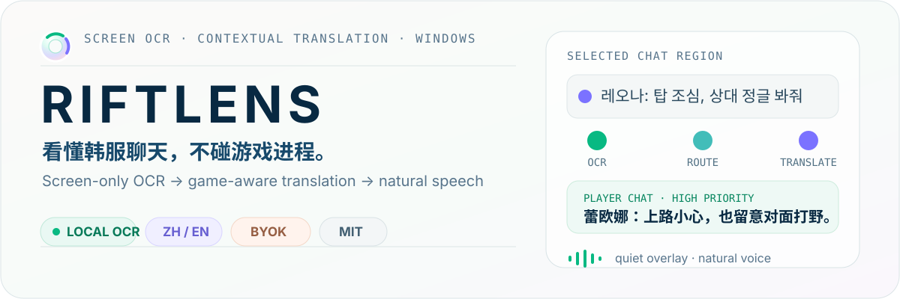
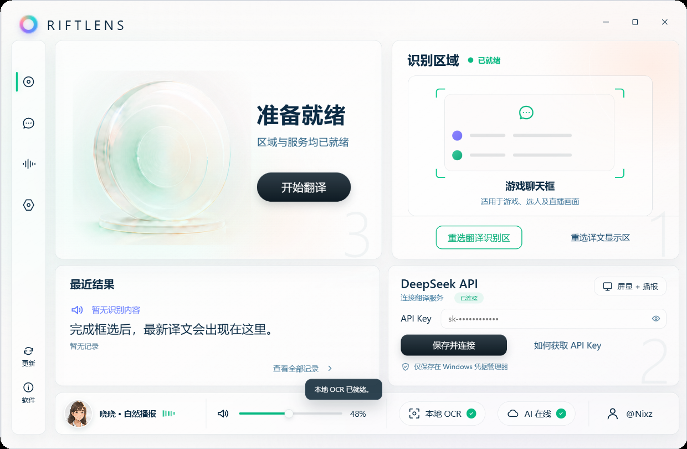
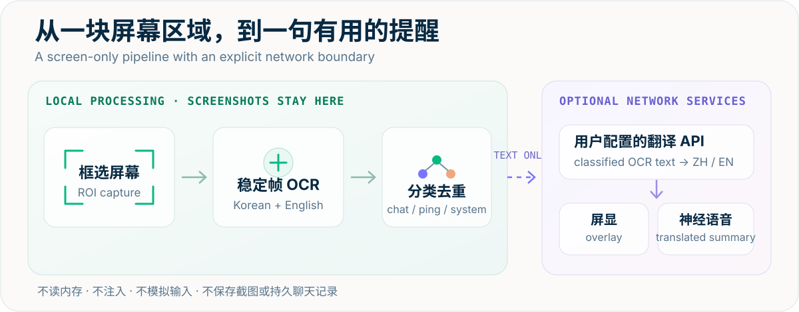
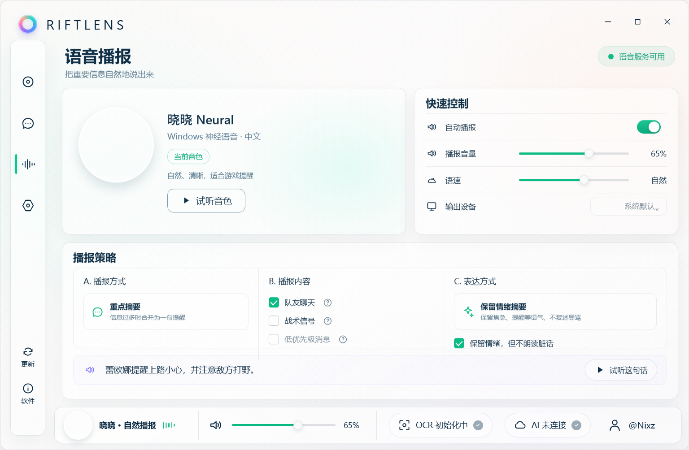

<div align="center">
  
</div>

<div align="center">
  <a href="README.md">简体中文</a> · <a href="README.en.md">English</a>
  <br><br>
  
  
  
  
</div>

> [!IMPORTANT]
> RiftLens 是作者个人vibe coding开发的可运行 MVP，并非 Riot Games 官方产品。使用前请阅读[游戏兼容性与免责声明](#游戏兼容性与免责声明)；低侵入设计不等于零风险承诺。

## 一眼看懂

游玩LOL韩服或者观看直播的时候，即使有设置官方语言翻译，也会因为本土玩家消息采用韩文而无法理解。针对这个问题，我制作了这个软件。

RiftLens 是一款面向 **LOL 韩服游戏聊天、英雄选择聊天和直播画面**的 Windows 屏幕文字翻译助手。框选一块屏幕区域后，它在本地完成截图、变化检测与韩英 OCR，再把筛选后的文字交给用户自行配置的 AI 服务翻译，并以低干扰字幕或自然语音呈现。

它不读取游戏内存、不注入游戏、不模拟键鼠、不替用户发送消息，也不捆绑任何 API Key。

<div align="center">
  
</div>

## 适合这些场景

| 场景 | RiftLens 做什么 |
| --- | --- |
| LOL 韩服对局 | 识别玩家发言，过滤大部分系统事件，并将重要内容翻译或播报 |
| 英雄选择阶段 | 自由框选选择英雄聊天区，不依赖固定 HUD 坐标 |
| 观看韩服直播 | 框选直播画面中的聊天或字幕区域，作为通用韩文屏幕翻译器使用 |
| OCR 与语境翻译研究 | 提供一个体量克制的 WinForms、WebView2、Tesseract 与 OpenAI-compatible 参考实现 |

## 核心特点

- **只看屏幕。** 自由框选识别区，也可单独框选译文显示区；框选时主界面自动隐藏，完成后恢复。
- **OCR 开箱即用。** 内置 `kor` 与 `eng` 的 `tessdata_fast` 模型，不要求用户另装韩语 OCR 包。
- **为滚动聊天优化。** 小区域低频采样、画面变化检测、稳定帧识别、残行过滤、时间戳清理与上滚去重协同工作。
- **先分类，再翻译。** 区分玩家聊天、战术信号、击杀事件、系统事件与未知文字；玩家发言拥有最高播报优先级。
- **忠实的轮次总结。** 同一玩家连续发言会聚合；换人时总结上一位玩家的完整意思，保留对象、位置、动作和原因，不用“队友在交流”之类空话替代内容。
- **文明化但不抹掉情绪。** 正常沟通保留原意；不友善内容删除具体攻击措辞，仍尽量保留其中可用的战术信息和大致情绪。
- **英雄名称不猜测。** 内置 Data Dragon 16.14.1 的 173 名英雄中、韩、英名称映射；只有文字中实际命中英雄名时才使用角色名，否则称“队友”。
- **自然语音与降级。** 中文默认尝试 `zh-CN-XiaoxiaoNeural`，英文使用 `en-US-JennyNeural`；在线语音不可用时安静地回退到 Windows 本地语音。
- **不抢游戏焦点。** 译文层不激活、鼠标穿透并排除自身截图；微型悬浮控件支持暂停、继续、音量和静音。
- **中英双语。** 界面、AI 输出、战术信号、历史列名和语音语言统一切换，并有双语交互自动化检查。

## 数据如何流动

<div align="center">
  
</div>

| 数据 | 去向 | 是否持久化 |
| --- | --- | --- |
| 框选区域截图 | 仅本机内存中的变化检测与 Tesseract OCR | 否 |
| OCR 后的新文字、发言人标签、英雄命中与摘要偏好 | 用户配置的 OpenAI-compatible 翻译接口 | 由该服务的政策决定 |
| AI 生成的播报文字 | 启用在线神经语音时发送给 Microsoft Edge 在线语音服务 | RiftLens 不保存 |
| API Key | Windows 凭据管理器，目标名 `RiftLens/TranslationApi` | 是，由当前 Windows 用户保护 |
| 其他设置和区域坐标 | `%LOCALAPPDATA%\RiftLens\settings.json`，不含 API Key | 是 |
| 翻译历史 | 仅当前运行会话的内存与界面 | 关闭后清除 |

完整说明见 [PRIVACY.md](PRIVACY.md)。使用联网翻译或在线语音即表示相关文本会受对应第三方服务条款和隐私政策约束。

## 快速开始

### 运行环境

- Windows 10 22H2 或 Windows 11，x64。
- Microsoft Edge WebView2 Runtime；当前 Windows/Edge 通常已包含。
- 小体积发布包需要 .NET 8 Desktop Runtime；自包含发布包不需要预装 .NET。
- 游戏推荐无边框窗口模式。独占全屏不保证能显示第三方悬浮层。

### 从源码运行

```powershell
git clone https://github.com/Nixz0824/RiftLens.git
cd RiftLens
powershell -NoProfile -ExecutionPolicy Bypass -File ./build.ps1
powershell -NoProfile -ExecutionPolicy Bypass -File ./run.ps1
```

`build.ps1` 会构建主程序与自测项目，并执行本地逻辑自检。它不会要求或读取你的翻译 API Key。

### 第一次使用

1. 在首页选择 **框选翻译识别区**，只圈住聊天或需要翻译的文字。
2. 等待内置 OCR 显示就绪。
3. 配置可从中国大陆网络访问的 OpenAI Chat Completions 兼容地址、模型与自己的 API Key。
4. 点击 **开始翻译** 后返回游戏；首次扫描只建立屏幕历史基线，不会突然播报旧消息。
5. 在翻译记录页对照“OCR 识别原文”和译文，检查你的 HUD 缩放、聊天字号与框选范围是否合适。

> [!NOTE]
> RiftLens 采用 BYOK（Bring Your Own Key）。项目不会提供、共享或预置 DeepSeek/OpenAI 等服务的 Key。DeepSeek 只是默认配置，兼容端点和模型均可更换。

## 界面

<table>
  <tr>
    <td width="50%"></td>
    <td width="50%"></td>
  </tr>
  <tr>
    <td align="center"><strong>翻译记录</strong><br>分列核对 OCR 原文与译文，支持搜索、筛选、滚动与展开</td>
    <td align="center"><strong>语音播报</strong><br>调整音量、播报密度、战术信号与情绪保留策略</td>
  </tr>
</table>

首页只保留“识别区域 → API → 开始翻译”三步；详细过滤、悬浮显示、运行方式与语言选项集中在设置页。游戏内悬浮控件使用原生轻量窗口，主设置界面则由本地 WebView2 页面呈现。

## 架构

```text
RiftLens/
├─ Models/       设置、区域、翻译请求与结果模型
├─ Services/     截图、预处理、OCR、去重、分类、翻译与语音
├─ UI/           WinForms 主窗口、框选器、译文层与悬浮控制
├─ WebUI/        随程序本地打包的 HTML / CSS / JavaScript 界面
└─ Assets/       英雄词典和韩英 OCR 模型

RiftLens.SelfTest/
├─ Program.cs                    核心逻辑与边界回归测试
└─ webui-interaction-test.js     中英文界面的实际点击交互测试
```

详细组件职责、线程边界和扩展点见 [docs/ARCHITECTURE.md](docs/ARCHITECTURE.md)。项目刻意保持为两个 .NET 项目和少量本地资源，不引入服务端、数据库或大型前端构建链。

## 构建、测试与发布目录

```powershell
# 构建并执行核心自检
powershell -NoProfile -ExecutionPolicy Bypass -File ./build.ps1

# 单独运行双语 WebUI 点击测试（需要 Microsoft Edge）
node ./RiftLens.SelfTest/webui-interaction-test.js

# 小体积、依赖目标电脑的 .NET 8 Desktop Runtime
powershell -NoProfile -ExecutionPolicy Bypass -File ./publish.ps1

# 体积较大、不要求目标电脑预装 .NET
powershell -NoProfile -ExecutionPolicy Bypass -File ./publish.ps1 -SelfContained
```

发布结果只写入被 Git 忽略的 `artifacts/`。CI 在 Windows 上构建、运行核心测试、检查双语界面，并生成不自动发布的可下载构建产物。

## 当前限制

- OCR 精度仍受聊天字号、HUD 缩放、动态背景、字体描边、压缩画质和框选范围影响；尚未承诺特定准确率。
- 分类器优先减少“把系统通知当玩家发言”的误播，但新版本客户端或特殊汉化文本仍可能出现未知格式。
- 区域当前按屏幕绝对坐标保存；切换显示器、分辨率或窗口位置后可能需要重新框选。
- 在线 AI 与神经语音都依赖用户所在网络环境和第三方服务可用性。
- 当前为源码优先的个人 MVP；正式 Release 二进制应在真实对局、杀毒软件和全新 Windows 环境验证后再发布。

## 游戏兼容性与免责声明

RiftLens 只处理屏幕像素，不读取或修改游戏进程，不注入、不抓包、不自动操作，也不会代替玩家发送内容。这些边界用于降低性能与反作弊风险，但**不代表 Riot Games 的认可，也不构成兼容性、账号安全或零封号风险保证**。游戏和反作弊规则可能变化，用户应自行确认当地法规、Riot Games 当前条款与所在平台规则。

RiftLens isn't endorsed by Riot Games and doesn't reflect the views or opinions of Riot Games or anyone officially involved in producing or managing Riot Games properties. Riot Games and all associated properties are trademarks or registered trademarks of Riot Games, Inc.

League of Legends、英雄名称、Data Dragon 数据及相关视觉与文字资产的权利归 Riot Games 或相应权利人所有。本仓库不包含游戏客户端资产；英雄名称映射仅用于必要的互操作和语境翻译。

## 版权与第三方组件

RiftLens 自有源代码以 [MIT License](LICENSE) 开源，Copyright © 2026 Nixz。第三方组件及数据不因本项目 MIT 许可而改变原许可证，包括 Tesseract、tessdata_fast、Tesseract .NET wrapper、Leptonica、NAudio、Microsoft WebView2 与 Riot Data Dragon。详情见 [THIRD_PARTY_NOTICES.md](THIRD_PARTY_NOTICES.md)。

在线语音由 Microsoft 服务提供时，还受 Microsoft 的服务条款与可用性约束；本项目不拥有或转售对应音色。

## 参与与安全

- 提交代码前请阅读 [CONTRIBUTING.md](CONTRIBUTING.md)。
- 漏洞与敏感问题请按 [SECURITY.md](SECURITY.md) 私下报告，不要在公开 Issue 粘贴 Key、聊天记录或本机路径。
- 版本变化见 [CHANGELOG.md](CHANGELOG.md)。

个人开发者：**Nixz**（GitHub [@Nixz0824](https://github.com/Nixz0824)）。欢迎以 Issue 或 Pull Request 交流，但请保持项目“小而清楚”的定位。
