# RiftLens architecture

RiftLens is intentionally a small Windows desktop application: one WinForms executable, one self-test project, a local WebView2 interface, and no backend or database.

## Data path

```mermaid
flowchart LR
    A["User-selected screen region"] --> B["ScreenCaptureService"]
    B --> C["ImageChangeDetector"]
    C --> D["BundledOcrService"]
    C -->|"explicit Vision consent"| VG["local obstruction preflight"]
    VG -->|"accepted crop"| DV["DeepSeek Vision literal OCR"]
    VG -->|"large obstruction"| VB["skip upload"]
    D --> E["PP-OCRv5 Mobile detector"]
    E --> E1["Korean + English recognizer"]
    E --> E2["Chinese + English recognizer"]
    E1 --> E3["word-segment and Unicode-script fusion"]
    E2 --> E3
    D -. "runtime failure or unusable result" .-> T["BitmapPreprocessor + Tesseract fallback"]
    E3 --> VH["VisionOcrPostProcessor"]
    DV --> VH
    VH --> F0["GameTimestampPrefixParser"]
    E3 --> F0
    F0 --> F["MessageDeduplicator"]
    T --> F
    F --> G["ChatMessageClassifier"]
    G -->|"free player chat"| P["PlayerHeroSessionTracker"]
    P --> H["PlayerTurnAggregator"]
    G -->|"Ping / HUD share"| S["GameSemanticEventParser"]
    S --> I["deterministic event formatter"]
    G -->|"other optional tactical signal"| I
    G -->|"low-confidence / unknown"| U["literal display only"]
    G -->|"system / kill"| X["discard"]
    H --> J["OpenAI-compatible translator"]
    J --> V["TranslationSemanticGuard"]
    I --> K["priority queue"]
    V --> K
    K --> L["translation overlay"]
    K --> M["neural or local speech"]
```

In Local OCR mode, screenshots stay in memory. In consented Vision mode, a JPEG of the selected crop may be uploaded only after a local obstruction check and only when player chat is still unresolved. Translation still receives classified text, not images. Online speech receives the generated spoken summary, not the screenshot or API key.

## Components

| Area | Main types | Responsibility |
| --- | --- | --- |
| Settings | `AppSettings`, `SettingsStore`, `CredentialStore` | Persist ordinary settings to LocalAppData and API keys to Windows Credential Manager |
| Capture | `ScreenCaptureService`, `CaptureCoordinator` | Sample the selected rectangle, coordinate pause/cancel, and feed the pipeline |
| OCR | `ImageChangeDetector`, `VisionUploadGuard`, `BundledOcrService`, `PaddleOcrEngine`, `TrilingualOcrFusion`, `DeepSeekVisionOcrService`, `VisionOcrPostProcessor`, `TesseractFallbackOcrEngine` | Detect meaningful changes; block clearly obstructed crops locally before upload; keep local OCR as the default; in explicitly consented Vision mode retain DeepSeek as the primary text source while local OCR supplies geometry, colour, constrained official-field corroboration, and immediate fallback |
| Message logic | `MessageDeduplicator`, `ChatMessageClassifier`, `GameSemanticEventParser`, `PlayerCalloutParser`, `PlayerHeroSessionTracker`, `PlayerTurnAggregator` | Remove old scrolling lines, separate deterministic Ping/HUD events from free chat, interpret flash-timer slang and item-bar inspects locally, learn stable player/champion pairs, and aggregate consecutive player messages |
| Diagnostics | `DiagnosticSessionRecorder` | Keep a bounded, redacted trace in memory and write it only when the user explicitly selects Export diagnostics |
| Translation | `OpenAiCompatibleTranslationService`, `TranslationSemanticGuard`, `HeroDictionary`, `GameTermGlossary` | Align official Korean/Chinese/English terms, keep literal display lines separate from speech summaries, and reject unsupported evidence, number, negation, countdown, or action claims |
| Speech | `PlayerSpeechPolicy`, `PlayerSpeechTextSanitizer`, `NaturalSpeechService`, `EdgeNeuralSpeechClient`, `SignalMessageTemplates` | Classify player speech into three user-controlled tiers, remove timestamps/player IDs, prioritize urgent audio, synthesize natural speech, and fall back locally |
| Native UI | `MainForm`, `RegionSelectorForm`, `TranslationOverlayForm`, `OverlayControlForm`, `LayeredWindowSurface` | Own the window lifecycle, selection, anti-aliased click-through overlay, fixed custom display bounds, and a floating control with pause, mute, and reselect |
| Web UI | `WebWorkspace`, `WebUI/*` | Render the main four-page interface from packaged local files and exchange typed messages with the host |

## Threading and lifecycle

- The WinForms UI thread owns windows and WebView2.
- `CaptureCoordinator` runs capture/OCR and translation work with cancellation and bounded asynchronous queues.
- ONNX Runtime uses CPU execution, sequential mode, one intra-op thread, and one inter-op thread. OCR requests never accumulate or run concurrently.
- Pausing stops new capture and cancels the current generation. Late responses are ignored.
- The first OCR result after start or resume establishes a deduplication baseline, preventing old visible chat from being announced.
- Hiding the main window suspends its WebView2 rendering while lightweight native capture and overlay components continue.

## Message policy

1. Player chat is always translated; speech is independently enabled for urgent, key, and neutral content.
2. Consecutive messages from the same speaker form one turn.
3. A speaker change completes and summarizes the prior turn.
4. Player chat is identified primarily by its channel/player ID/`(champion):` structure. Cyan metadata and neutral message colours are supporting evidence only when OCR drops delimiters.
5. Only bracketed champion tokens that resolve through the official catalog vote toward a per-session player/champion relationship. A three-observation majority locks the pairing; pause/resume retains it, while a new listening session resets it.
6. Official champion abilities, summoner spells, items, and runes are aligned by stable Data Dragon IDs before AI translation. Common player shorthand is maintained separately.
7. Before free chat reaches AI, deterministic Korean/Chinese/English Ping and HUD-share forms are parsed into source type, speech act, subject, target, status, duration, modality, confidence, and evidence.
8. A HUD separator such as `Flash - 20s` is structural, never a negative sign. Marker, status, countdown, request, and plan events cannot become ongoing actions.
9. Tactical signals, kill events, map-objective/structure events, client/wellness reminders, and match-flow/system notices have independent switches and default to off.
10. Enabled system categories are rate-limited, wait for player chat to become idle, and use deterministic local summaries instead of the user's AI endpoint.
11. Free-chat AI summaries must return an exact source evidence fragment. Local validation preserves numbers and negation and requires explicit source evidence for ongoing actions; failed validation silences speech without removing literal overlay text.
12. Urgent warnings can skip the normal aggregation wait and pre-empt lower-priority audio. Key messages are grouped briefly; neutral speech defaults to off.
13. Generic summaries are rejected for ordinary tactical messages. Speech never includes timestamps, player IDs, or pure hostility; a civilised translation may still appear as text.
14. Low-confidence text becomes `Unknown`: it is displayed literally, never sent to AI for classification, and never spoken.
15. The audio worker applies a final policy gate using the latest settings immediately before synthesis or local playback, so already queued system messages cannot bypass a switch that was turned off.
16. The overlay renders the resolved speaker once as a heading, then shows literal translated lines rather than the speech summary and pairs each with its corresponding cleaned original line when original-text display is enabled.
17. A dedicated line-start timestamp parser handles full-width punctuation and evidence-backed OCR damage before speaker parsing. A final speech-only guard removes any valid residual clock prefix before TTS.
18. Player-authored chat, player-initiated game signals, unattributed game-generated signals, and fixed game-system notices keep distinct source labels. Only player-authored chat uses a “speaker says” framing.
19. Diagnostic traces are memory-only by default. Explicit export omits screenshots and credentials and replaces recognized player IDs with session aliases.
20. Riot Data Dragon `zh_TW` champion, ability, summoner-spell, item, and rune aliases share the same stable IDs as Korean, Simplified Chinese, and English. Fuzzy correction is restricted to deterministic HUD fields and must resolve uniquely.
21. Vision consent alone does not guarantee upload: `VisionUploadGuard` blocks a clearly dominant opaque obstruction locally before JPEG encoding. `VisionDispatchPolicy` then skips HUD-only frames; only unresolved player chat is uploaded, as native-size JPEG, and in-flight work keeps the latest frame.
22. Player-authored flash-timer slang (`1213mid`, `mid f on`) and colon-form enemy item-bar inspects are formatted locally and spoken as player chat. Colon-less generated HUD item marks stay tactical.

Classification is heuristic because the application sees pixels rather than structured game events. New client/localization patterns should be added as deterministic self-test cases before rules change.

## Extension points

- Implement `ITranslationService` for another text service while preserving the same privacy boundary.
- Extend `ChatMessageClassifier` with redacted or synthetic fixtures.
- Add a new language through UI copy, signal templates, hero names, OCR data, and speech as one complete change.
- Store capture boxes as fractions of the League client area (`ScreenRegion` relative fields). Absolute pixels remain the fallback when no game window is found.
- Ask the translation model only for one-to-one `displayLines`. Local speech planning, `TranslationSemanticGuard`, and `FinalSpeechPolicy` own narration.

Avoid turning the app into a game integration layer. Memory access, injection, packet capture, input automation, automatic replies, mandatory accounts, telemetry, and a hosted backend are outside project scope.
