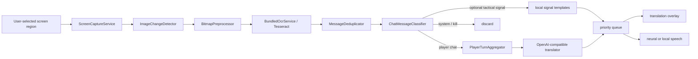

# RiftLens architecture

RiftLens is intentionally a small Windows desktop application: one WinForms executable, one self-test project, a local WebView2 interface, and no backend or database.

## Data path

Screenshots end at local OCR. The network translation boundary begins only after deduplication and classification. Online speech receives the generated spoken summary, not the screenshot or API key.

## Components

| Area | Main types | Responsibility |
| --- | --- | --- |
| Settings | `AppSettings`, `SettingsStore`, `CredentialStore` | Persist ordinary settings to LocalAppData and API keys to Windows Credential Manager |
| Capture | `ScreenCaptureService`, `CaptureCoordinator` | Sample the selected rectangle, coordinate pause/cancel, and feed the pipeline |
| OCR | `BitmapPreprocessor`, `ImageChangeDetector`, `BundledOcrService` | Detect meaningful changes, improve small text, reject unstable edges, and run bundled Korean/English OCR |
| Message logic | `MessageDeduplicator`, `ChatMessageClassifier`, `PlayerTurnAggregator` | Remove old scrolling lines, classify event types, and aggregate consecutive player messages |
| Translation | `OpenAiCompatibleTranslationService`, `HeroDictionary`, `GameTermGlossary` | Send structured text, constrain output, align champion names, and validate summaries |
| Speech | `NaturalSpeechService`, `EdgeNeuralSpeechClient`, `SignalMessageTemplates` | Prioritize player speech, synthesize natural audio, and fall back locally |
| Native UI | `MainForm`, `RegionSelectorForm`, `TranslationOverlayForm`, `OverlayControlForm` | Own the window lifecycle, selection, click-through overlay, and floating control |
| Web UI | `WebWorkspace`, `WebUI/*` | Render the main four-page interface from packaged local files and exchange typed messages with the host |

## Threading and lifecycle

- The WinForms UI thread owns windows and WebView2.
- `CaptureCoordinator` runs capture/OCR and translation work with cancellation and bounded asynchronous queues.
- Pausing stops new capture and cancels the current generation. Late responses are ignored.
- The first OCR result after start or resume establishes a deduplication baseline, preventing old visible chat from being announced.
- Hiding the main window suspends its WebView2 rendering while lightweight native capture and overlay components continue.

## Message policy

1. Player chat is the first priority.
2. Consecutive messages from the same speaker form one turn.
3. A speaker change completes and summarizes the prior turn.
4. Tactical signals are rate-limited and spoken only when player chat is not waiting.
5. Kill, surrender, structure, reconnect, health-reminder, and other known system events are not sent to speech.
6. Generic summaries are rejected for ordinary tactical messages; vague protective phrasing is allowed only for pure hostility without useful tactical content.

Classification is heuristic because the application sees pixels rather than structured game events. New client/localization patterns should be added as deterministic self-test cases before rules change.

## Extension points

- Implement `ITranslationService` for another text service while preserving the same privacy boundary.
- Extend `ChatMessageClassifier` with redacted or synthetic fixtures.
- Add a new language through UI copy, signal templates, hero names, OCR data, and speech as one complete change.
- Add display-relative region profiles without changing the capture pipeline.

Avoid turning the app into a game integration layer. Memory access, injection, packet capture, input automation, automatic replies, mandatory accounts, telemetry, and a hosted backend are outside project scope.
